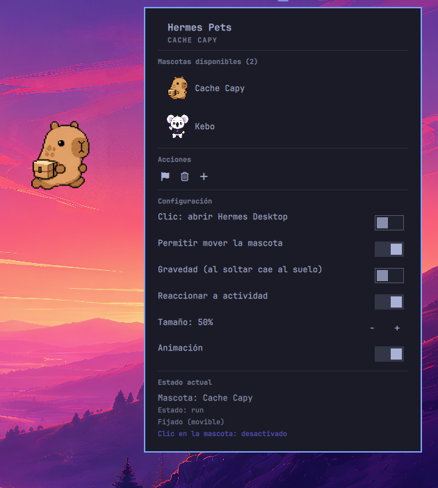

<div align="center">

# Hermes Pets

**Mascota animada y autocontenida para la barra y el escritorio de Omarchy**

[](https://omarchy.org)
[](https://hyprland.org)
[](#requisitos)
[](#idiomas)
[](LICENSE)

<br/>



</div>

---

## Qué hace

**Hermes Pets** es un plugin para la barra de **Omarchy** que vive **100 % dentro de su propia carpeta** (sin depender de `hermes`, `curl` ni paquetes externos). Incluye catálogo integrado de [petdex.dev](https://petdex.dev), motor de física propio, IA ambiental de movimiento e idioma automático del sistema.

| Capacidad | Detalle |
|---|---|
| **Autocontenido** | Gestiona escaneo, catálogo, descarga e instalación desde [`petdex.py`](petdex.py) usando solo la librería estándar de Python 3. Las mascotas se guardan en `pets/`. |
| **Catálogo integrado (+5,300 pets)** | Busca, instala y elimina mascotas directamente desde el panel con caché local y validación estricta de atlas (`1536×N·208`, PNG/WebP). |
| **Física e IA ambiental** | Pausas exponenciales naturales, caminata sincronizada con la cadencia del sprite, **lanzamiento con inercia + rebotes** en paredes/techo/suelo, saltos espontáneos y **vuelo libre 2D** opcional. |
| **Animaciones completas** | Todas las filas del atlas (`idle`, `running-right/left`, `waving`, `jumping`, `failed` en impactos fuertes, `waiting`, `running`, `review` y seguimiento del cursor en hojas v2), sombra de contacto dinámica y partículas de corazones. |
| **Multimonitor seguro** | [`PinCoordinator.js`](PinCoordinator.js) garantiza una sola mascota fijada en el escritorio aunque tengas varios monitores. |
| **Idioma automático** | Detecta el idioma de tu PC / Omarchy en vivo vía `Commons.Translations` (`en`, `es`, `pt`, `fr`, `de`, `it`, `ru`). |

---

## Instalación rápida

```sh
git clone https://github.com/Madmasx/hermes-pets-omarchy.git
omarchy plugin add ./hermes-pets-omarchy --enable
omarchy restart shell
```

### Requisitos

- **Omarchy** con su barra Quickshell (`omarchy-shell`) sobre Hyprland.
- **Python 3** (solo biblioteca estándar, incluido en Arch/Omarchy).

---

## Controles e interacciones

| Acción | Resultado |
|---|---|
| **Clic en el icono de la barra** | Abre / cierra el panel de control y lista de mascotas |
| **Botón `+` en el panel** | Abre el catálogo integrado de `petdex.dev` |
| **Clic en la mascota fijada** | Saluda con corazones (y ejecuta `clickCommand` si está activo) |
| **Doble clic en la mascota** | Salto de celebración con corazones |
| **Arrastrar y soltar** | Mueve la mascota o **lánzala con impulso** para que rebote |
| **`Alt + rueda`** sobre la mascota | Escala manteniendo los pies anclados al suelo |

---

## Configuración

Todos los ajustes están disponibles en el panel o por CLI:

```sh
omarchy bar set madmasx.hermes-pets freeFlight true --json
```

| Clave | Tipo | Default | Descripción |
|---|---|---|---|
| `petId` | `string` | `""` | Carpeta de la mascota activa (vacío = primera instalada) |
| `petsDir` | `string` | `""` | Vacío = `<plugin>/pets/`; acepta ruta personalizada |
| `pinned` | `boolean` | `false` | Fijar la mascota sobre el escritorio |
| `pinnedX` / `pinnedY` | `integer` | `-1` | Posición guardada en píxeles (`-1` = centrada) |
| `animate` | `boolean` | `true` | Activa/pausa las animaciones del sprite |
| `randomBehavior` | `boolean` | `true` | Deambular, gestos espontáneos y saltos |
| `freeFlight` | `boolean` | `false` | Vuelo libre 2D por toda la pantalla (independiente de gravedad) |
| `movable` | `boolean` | `true` | Permitir arrastrar y lanzar la mascota fijada |
| `gravityEnabled` | `boolean` | `true` | Caída con gravedad y rebote al soltar en el aire |
| `smooth` | `boolean` | `true` | Escalado suave (desactivar para pixel art) |
| `petScale` | `number` | `0.75` | Factor de escala (`0.25` – `3.0`) |
| `activityEnabled` | `boolean` | `false` | Observa `<petsDir>/activity-state.json` en vivo |
| `launchOnClick` | `boolean` | `false` | Ejecuta `clickCommand` al hacer clic |
| `clickCommand` | `string` | `""` | Comando opcional al hacer clic |

---

## Idiomas

El panel detecta automáticamente el idioma del sistema / Omarchy (con fallback a inglés) sin reiniciar el shell:

`EN` · `ES` · `PT` · `FR` · `DE` · `IT` · `RU` — catálogos en [`i18n/`](i18n/).

---

<details>
<summary><strong>Espejo de actividad externo (opcional)</strong></summary>

<br/>

Si quieres que la mascota reaccione a un agente externo, activa `activityEnabled` y escribe JSON atómicamente en `<petsDir>/activity-state.json`:

```json
{"pose": "run", "updated_at": 1756000000.0}
```

- **Sostenidas:** `idle`, `run`, `review`, `waiting`
- **Transitorias (1 ciclo):** `wave`, `jump`, `failed`

El plugin opcional de hooks para Hermes vive en [`hermes-plugin/`](hermes-plugin/).

</details>

<details>
<summary><strong>Desarrollo y validación</strong></summary>

<br/>

```sh
# Validar estructura y manifest
omarchy plugin validate .

# Previsualizar widget con el tema actual (0 errores QML)
omarchy agent look plugin .

# Probar el gestor local sin dependencias
python3 -B petdex.py scan ./pets
python3 -B petdex.py catalog ./pets
```

Para desinstalar:

```sh
omarchy plugin remove madmasx.hermes-pets
```

</details>

---

## Créditos y licencia

- **Madmasx** — autor del plugin.
- Basado originalmente en [Omarchy Pets](https://plugins.omarchy.org/plugin.html?id=raiden-meixelysia.omarchy-pets) y sprites de [petdex.dev](https://petdex.dev) (cada mascota conserva su propia licencia).
- **Licencia:** MIT — ver [LICENSE](LICENSE).

---

## `$ ls ~/contacto`

[](https://x.com/madmasx)
[](https://github.com/madmasx)
[](https://buymeacoffee.com/madmasx)
